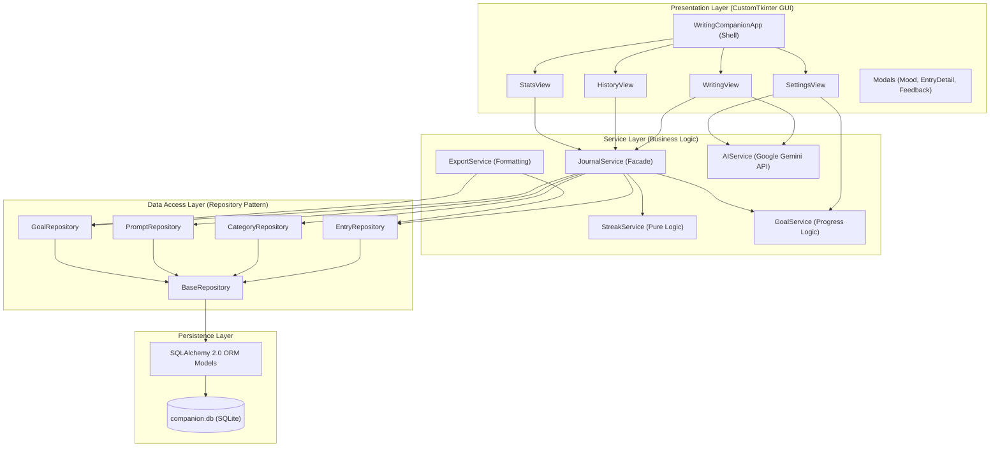
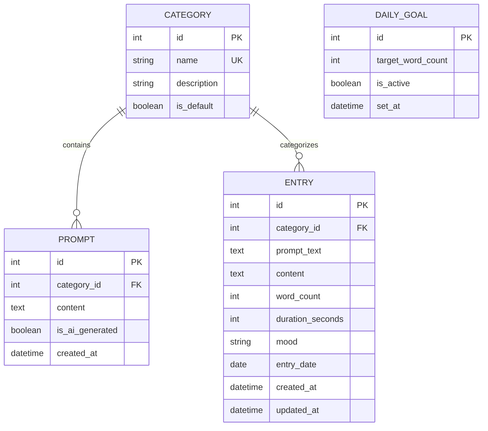

# ✍️ Daily Writing Companion

[](https://www.python.org/)
[](https://github.com/TomSchimansky/CustomTkinter)
[](https://www.sqlalchemy.org/)
[](https://www.sqlite.org/)
[](https://aistudio.google.com/)
[-brightgreen?style=for-the-badge&logo=pytest&logoColor=white)](https://pytest.org/)
[](#-software-architecture--design-patterns)

> **A modern, distraction-free desktop journaling and creative writing suite.**  
> Built with clean architecture, robust object-oriented principles, automated testing, and Google Gemini AI assistance.

---

## 📖 Table of Contents
- [Overview](#-overview)
- [Key Features](#-key-features)
- [Software Architecture & Design Patterns](#-software-architecture--design-patterns)
- [Database Schema](#-database-schema)
- [Project Directory Structure](#-project-directory-structure)
- [Getting Started](#-getting-started)
- [Running Automated Tests](#-running-automated-tests)
- [Data Migration](#-data-migration)
- [Roadmap & Enhancements](#-roadmap--enhancements)

---

## 🌟 Overview

**Daily Writing Companion** transforms the traditional command-line journaling habit into an elegant, distraction-free desktop application. Whether you are reflecting on your day, penning flash fiction, or crafting poetry, the application keeps you motivated through visual streaks, daily word goals, emotional mood logging, and real-time AI mentorship powered by the Google Gemini API.

Initially conceived as a procedural CLI script, this repository demonstrates how to refactor monolithic legacy code into a **production-ready, test-driven application** following software engineering industry best practices.

---

## ✨ Key Features

### 1. ✍️ Distraction-Free Writing Space
- **Curated & AI Prompts**: Rotate through default writing prompts across `Journal`, `Story`, and `Poem`, or generate fresh prompts on-demand via Gemini AI.
- **Live Word Counter & Goal Progress**: Real-time word calculation with dynamic progress bar changing to emerald green upon reaching the daily target.
- **Session Timer**: Live elapsed writing timer measuring duration down to the second.
- **Post-Writing Mood Tracking**: Modal prompt upon saving to log emotional state (`😔 Struggling`, `😐 Neutral`, `🙂 Good`, `😊 Great`, `🌟 Amazing`).

### 2. 📚 History & Advanced Search
- **Live Keyword Search**: Instant searching across both prompts and journal contents.
- **Multi-Facet Filtering**: Filter entries by category (`journal`, `story`, `poem`) and mood.
- **Full CRUD Management**: View full text, edit past entries (with automatic word count recalculation), or delete with safe confirmation dialogs.

### 3. 📊 Stats & Insights Dashboard
- **Streak Tracker**: Tracks current streak (with same-day grace period logic) and historical longest streak.
- **Goal Progress**: Visual bar meter of words written today against the daily target.
- **Writing Analytics**: Total entries, total words, average words per session, and category breakdown.
- **Mood Trends**: Distribution graph of post-writing emotional reflections.
- **One-Click Export**: Export your complete writing history to a formatted `.txt` file.

### 4. 🤖 AI Writing Partner (Google Gemini)
- **Dynamic Prompt Generator**: Generates 1-2 sentence creative prompts tailored to selected categories and current moods.
- **Constructive Writing Mentor**: Analyzes your draft to highlight vivid imagery, offer gentle vocabulary suggestions, and pose a reflective question.
- **Secure Credentials**: API keys stored in local `.env` (never hardcoded) with built-in connection verification.

---

## 🏛️ Software Architecture & Design Patterns

The codebase is engineered adhering to **Clean Architecture** and strict separation of concerns:



### Design Patterns Applied:
1. **Repository Pattern (`src/repositories/`)**:
   - Isolates the domain layer from data persistence queries. Swapping SQLite for PostgreSQL or another database requires zero modifications to business logic.
2. **Facade Pattern (`src/services/journal_service.py`)**:
   - Provides a unified, high-level interface to the complex subsystem of repositories and services for UI views.
3. **Pure Function Separation (`src/services/streak_service.py`)**:
   - Strips database dependencies away from algorithmic streak calculations, making streak edge cases 100% testable without mocking.
4. **Observer / Callback Pattern (`src/ui/app.py`)**:
   - Coordinates reactive state updates across sibling views (e.g. saving an entry immediately refreshes History and Dashboard views).

---

## 🗄️ Database Schema

Implemented via **SQLAlchemy 2.0** with strict typing and relational constraints:



---

## 📁 Project Directory Structure

```text
Daily-Writing-Companion/
│
├── config/
│   ├── __init__.py
│   └── settings.py              # Configuration, environment variables, default prompts
│
├── src/
│   ├── db/
│   │   ├── __init__.py
│   │   ├── base.py              # DeclarativeBase
│   │   └── session.py           # Engine & SessionFactory
│   │
│   ├── models/                  # SQLAlchemy 2.0 ORM Models
│   │   ├── category.py          # Category model
│   │   ├── prompt.py            # Prompt model
│   │   ├── entry.py             # Journal Entry model
│   │   └── goal.py              # Daily Word Count Goal model
│   │
│   ├── repositories/            # Data Access Layer
│   │   ├── base_repository.py   # Generic CRUD operations
│   │   ├── category_repository.py
│   │   ├── prompt_repository.py
│   │   ├── goal_repository.py
│   │   └── entry_repository.py  # Advanced filtering & search
│   │
│   ├── services/                # Business Logic Layer
│   │   ├── streak_service.py    # Algorithmic streak logic
│   │   ├── goal_service.py      # Goal progress calculations
│   │   ├── export_service.py    # Text formatting & export
│   │   ├── journal_service.py   # High-level domain facade
│   │   └── ai_service.py        # Google Gemini API client
│   │
│   └── ui/                      # CustomTkinter Desktop GUI
│       ├── app.py               # Main application shell & navigation
│       ├── components/          # Reusable modal dialogs (Mood, Edit, AI Feedback)
│       └── views/               # Screen views (Writing, History, Stats, Settings)
│
├── tests/                       # Automated Test Suite (20 tests)
│   ├── conftest.py              # Isolated in-memory SQLite fixtures
│   ├── test_models.py           # ORM entity tests
│   ├── test_repositories.py     # Repository CRUD & search tests
│   ├── test_services.py         # Streak & goal calculation tests
│   ├── test_ai_service.py       # AI client validation tests
│   ├── test_migration.py        # Data migration fidelity tests
│   └── test_ui_smoke.py         # GUI initialization smoke tests
│
├── scripts/
│   └── migrate_json_to_db.py    # Safe migration script from legacy data.json
│
├── .env.example                 # Environment configuration template
├── .gitignore                   # Git ignore rules
├── requirements.txt             # Dependency specification
├── main.py                      # Application launch entrypoint
└── README.md                    # Project documentation
```

---

## 🚀 Getting Started

### 1. Prerequisites
- Python 3.10+ (Tested up to Python 3.14)

### 2. Clone & Setup Virtual Environment
```bash
# Clone the repository
git clone https://github.com/your-username/daily-writing-companion.git
cd daily-writing-companion

# Create virtual environment
python -m venv .venv

# Activate virtual environment
# Windows (PowerShell):
.venv\Scripts\Activate.ps1
# macOS/Linux:
source .venv/bin/activate
```

### 3. Install Dependencies
```bash
pip install -r requirements.txt
```

### 4. Configure Environment Variables (Optional for Gemini AI)
Copy `.env.example` to `.env`:
```bash
cp .env.example .env
```
Edit `.env` with your Gemini API key (obtainable for free at [Google AI Studio](https://aistudio.google.com/)):
```env
GEMINI_API_KEY=your_gemini_api_key_here
APP_THEME=dark
```
*(Note: You can also enter and save your Gemini API key directly from inside the app's Settings view!)*

### 5. Launch the Desktop App
```bash
python main.py
```

---

## 🧪 Running Automated Tests

Run the complete unit and smoke test suite using `pytest`:

```bash
pytest -v
```

### Test Coverage Highlights:
- **`test_models.py`**: Model creation, word counting, relationships, and property helpers.
- **`test_repositories.py`**: Category seeding, prompt retrieval, goal activation, search by keyword, mood, and category.
- **`test_services.py`**: Consecutive streak computation, missed day handling, grace periods, and goal progress percentages.
- **`test_ai_service.py`**: Graceful fallbacks for missing keys, validation rules on short drafts, and key updating.
- **`test_migration.py`**: JSON backup verification and data fidelity checks.
- **`test_ui_smoke.py`**: GUI shell instantiation, navigation between all 4 views, and clean shutdown.

---

## 🔄 Data Migration

If you have historical entries in a legacy `data.json`, run the included migration script:

```bash
python scripts/migrate_json_to_db.py
```

The script will:
1. Create a timestamped backup (`data_backup_YYYYMMDD_HHMMSS.json`).
2. Initialize SQLite schema (`companion.db`).
3. Seed default curated prompts and categories.
4. Migrate all historical entries, word counts, and daily goals.
5. Perform an automated audit check ensuring 100% data fidelity.

---

## 📜 License

Distributed under the MIT License. See `LICENSE` for more information.
